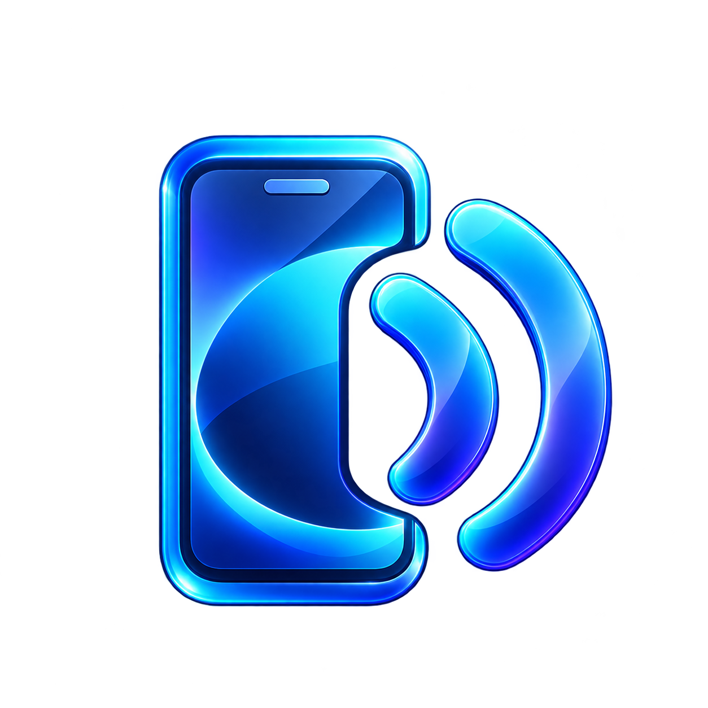

<p align="center">
  
</p>
<h1 align="center">Castino</h1>
<p align="center">Il tuo Android, sul tuo PC. Mirroring Wi-Fi e controllo da Windows.</p>
<p align="center">
  <a href="https://github.com/carellice/Castino/releases/latest"></a>
  <a href="LICENSE"></a>
</p>

Castino è un'app desktop open source per Windows, realizzata con WinUI 3 e .NET 8.
Mostra lo schermo di Android sul computer e permette di controllarlo con mouse, tastiera e touch.

## Scarica e avvia

1. Apri **[l'ultima release](https://github.com/carellice/Castino/releases/latest)**.
2. Scarica **`Castino-0.1.1-win-x64.zip`** dalla sezione **Assets** (nelle release successive, scegli lo ZIP della nuova versione).
3. Estrai **tutto** lo ZIP in una cartella e apri **`Castino.exe`**.

Non occorre installare .NET o Visual Studio: il pacchetto include i runtime necessari, ADB e scrcpy-server.
Mantieni le cartelle `Assets` e `tools` accanto all'eseguibile. I file «Source code» di GitHub contengono i sorgenti, non il programma pronto all'uso.

**Requisiti:** Windows 10 versione 1809 o successiva / Windows 11, processore x64, telefono Android.
Per il collegamento wireless con QR o codice serve Android 11+ e la stessa rete locale.
Per Android precedenti è disponibile il passaggio da USB a Wi-Fi.

La build non è firmata digitalmente: Windows potrebbe mostrare un avviso di reputazione.
La release include `SHA256SUMS.txt` per verificare l'integrità del download:

```powershell
Get-FileHash .\Castino-0.1.1-win-x64.zip -Algorithm SHA256
```

## Aggiornamenti dall'app

Dalla versione **0.1.1**, Castino controlla le release stabili di questa repository all'avvio e ogni 6 ore
mentre resta aperto. Nel pannello **Aggiornamenti** puoi disattivare il controllo automatico o premere
**Cerca aggiornamenti** in qualsiasi momento. Il controllo usa l'API pubblica di GitHub, senza account o token.
Se manca la rete, l'app continua a funzionare; un controllo manuale mostra l'eventuale errore.

Quando è disponibile una versione più recente, l'app mostra **Scarica aggiornamento**. Il download avviene
in background, può essere annullato e viene verificato con SHA-256 prima dell'estrazione.
Premi quindi **Installa e riavvia**: Castino chiude il mirroring, aggiorna i file e si riapre.
Le impostazioni e gli indirizzi salvati in `%LOCALAPPDATA%\Castino` vengono conservati.

L'aggiornamento richiede una cartella scrivibile dall'utente e supporta il pacchetto ZIP Windows x64.
Le installazioni MSIX devono essere aggiornate dal proprio canale di distribuzione.
L'aggiornatore conserva un backup dei file modificati nella propria cartella temporanea
`%TEMP%\Castino-Update-*` e tenta il ripristino se la copia fallisce. Un eventuale errore viene mostrato
e registrato in quella cartella. Chiudi eventuali altre istanze di Castino prima di installare.

**Chi usa la 0.1.0 deve scaricare manualmente la 0.1.1 una volta**, per ricevere questa funzione.
Da quel momento gli aggiornamenti successivi si gestiscono direttamente dall'app.

## Funzioni

- Video H.264 con decodifica Media Foundation e rendering Direct3D 11.
- Associazione con QR code o codice numerico, ricerca in rete tramite mDNS e connessione manuale.
- Controllo con mouse, tastiera e touchscreen; copia degli appunti del PC sul telefono.
- Scorrimento fluido, zoom con Ctrl + rotellina e velocità di scorrimento regolabile.
- Risoluzione, bitrate e frequenza dei fotogrammi configurabili.
- Schermo intero, rotazione e spegnimento dello schermo del telefono durante il mirroring.

Il supporto attuale è **Android**. Audio e iPhone/iPad non sono implementati.
La latenza dipende dalla rete e dall'encoder del telefono; per ridurla usa Wi-Fi a 5/6 GHz e una risoluzione moderata.

## Collega il telefono

1. Attiva le **Opzioni sviluppatore** di Android (Impostazioni → Info telefono → tocca 7 volte Numero build).
2. Su Android 11+, attiva **Debug wireless**. In Castino scegli **Associa nuovo telefono con QR code**;
   sul telefono apri **Debug wireless → Associa dispositivo con codice QR** e inquadra il codice.
   In alternativa usa l'associazione con codice numerico.
3. Seleziona il telefono e premi **Avvia mirroring**. Accetta eventuali richieste di autorizzazione sul telefono.

Per Android precedenti: attiva **Debug USB**, collega il telefono con un cavo, autorizza il PC e premi
**Passa al Wi-Fi** in Castino. Puoi quindi staccare il cavo; ripeti dopo il riavvio del telefono.
Usa il debug solo con computer e reti di fiducia e disattivalo quando non serve più.

| Comando | Azione |
| --- | --- |
| Clic / trascinamento | Tocco / swipe |
| Clic destro / centrale | Indietro / Home |
| Rotellina / Maiusc + rotellina | Scorrimento verticale / orizzontale |
| Ctrl + rotellina | Zoom a pizzico |
| Ctrl + V | Incolla sul telefono |
| Alt + H / S / N | Home / app recenti / notifiche |
| Alt + ↑ / ↓ | Volume |
| Alt + R / P | Ruota / accensione |
| F11 | Schermo intero |

## Compila dai sorgenti

Servono Windows e **.NET 8 SDK**. Visual Studio non è obbligatorio.

```powershell
git clone https://github.com/carellice/Castino.git
cd Castino
dotnet build src/Castino/Castino.csproj -c Debug -p:Platform=x64
```

L'eseguibile di sviluppo si trova in
`src/Castino/bin/x64/Debug/net8.0-windows10.0.19041.0/win-x64/Castino.exe`.

Per produrre lo ZIP autonomo e il checksum della release:

```powershell
./scripts/New-Release.ps1 -Version 0.1.1
```

Lo script scrive in `dist/` e richiede una cartella di output non già presente.
Il workflow GitHub Actions compila e pubblica una release quando viene caricato un tag `vX.Y.Z`;
può anche essere avviato manualmente per ottenere un artefatto di compilazione.
Le release pronte all'uso sono attualmente **solo x64**.
Le release vengono pubblicate dopo il caricamento dello ZIP e del checksum, così l'app propone solo pacchetti completi.

Test dell'aggiornatore (con risposte HTTP simulate, senza scaricare release):

```powershell
dotnet run --project tests/Castino.UpdateTests -c Release
./tests/Test-UpdateInstaller.ps1
```

Per generare un MSIX destinato allo Store:

```powershell
dotnet publish src/Castino/Castino.csproj -c Release -p:Platform=x64 -p:Packaged=true -p:GenerateAppxPackageOnBuild=true -p:AppxPackageSigningEnabled=false -p:AppxPackageDir=dist/
```

Prima dell'invio allo Store sostituisci i valori segnaposto di identità in `Package.appxmanifest`
con quelli assegnati da Partner Center.

## Architettura

- `Android/`: ADB, associazione QR, avvio di scrcpy-server e protocollo di controllo.
- `Mirroring/`: interfaccia delle sessioni, scorrimento e sorgente video di test (Debug).
- `Video/`: decoder H.264 Media Foundation e renderer Direct3D 11.
- `MainWindow.xaml(.cs)`: interfaccia e inoltro dell'input.
- `Updates/` e `MainWindow.Updates.cs`: controllo release GitHub, download verificato e aggiornamento con backup.
- `tools/`: ADB e scrcpy-server 5.0.1, con i relativi avvisi di licenza.

Castino avvia scrcpy-server sul telefono attraverso ADB e riceve video H.264 tramite un tunnel locale.
I comandi di controllo viaggiano su un secondo socket. La versione del server deve corrispondere a
`ScrcpySession.ServerVersion`.

In Debug, `CASTINO_TEST_PATTERN=1` abilita una sorgente video simulata per verificare rendering e input senza telefono.

## Contribuire

Segnalazioni e pull request sono benvenute: descrivi versione di Windows e Android, passaggi per riprodurre
il problema e risultato atteso. Non includere indirizzi privati, codici di associazione o dati personali nei log.

## Licenza e crediti

Il codice e le risorse originali di Castino sono distribuiti con [licenza MIT](LICENSE).
I componenti inclusi conservano le proprie licenze: vedi [THIRD-PARTY-NOTICES.md](THIRD-PARTY-NOTICES.md).
Castino utilizza [scrcpy](https://github.com/Genymobile/scrcpy), Android Platform-Tools, QRCoder,
Vortice.Windows e Windows App SDK. Non è affiliato a Google o Microsoft.
